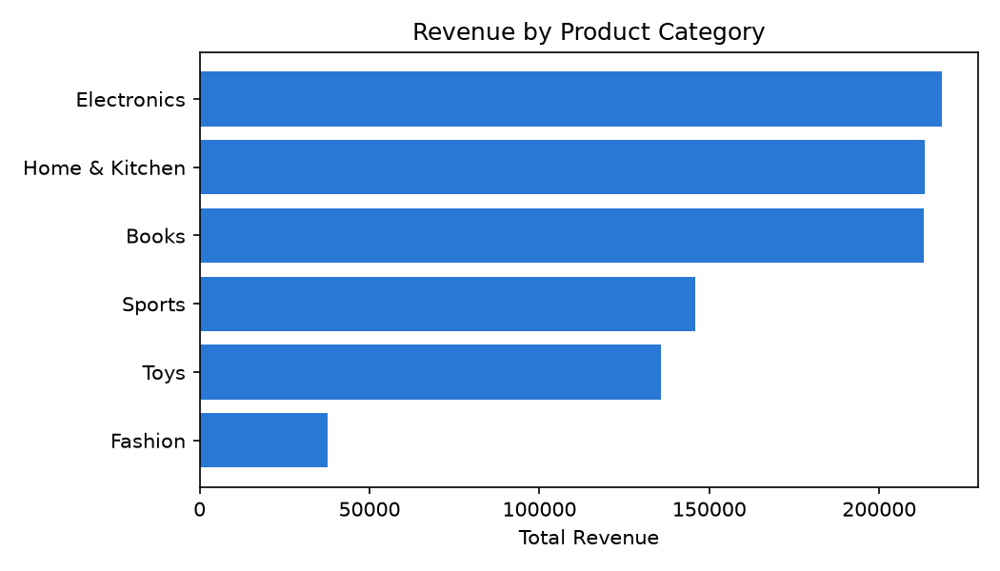
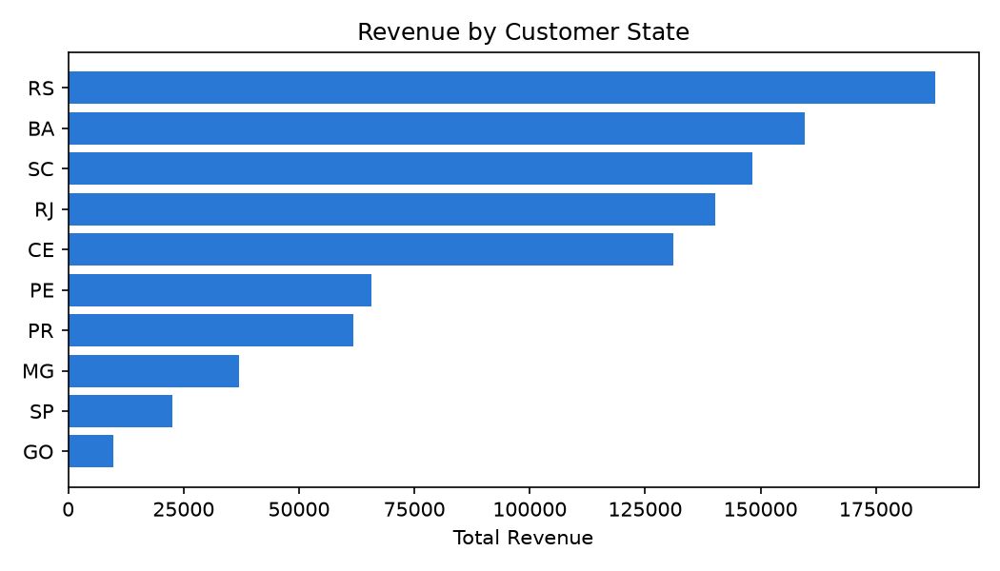

# E-commerce Sales Pipeline

A small batch data pipeline that cleans, validates, and aggregates e-commerce order data using **PySpark**, orchestrated by an **Apache Airflow** DAG.

## What it does

1. **Ingests** raw CSVs for customers, products, orders, and order items (synthetic data, generated locally, with intentionally injected data quality issues: duplicate rows, orphan foreign keys, invalid quantities, negative prices).
2. **Validates** every order line against a set of data-quality rules — referential integrity against orders/products, positive quantity, non-negative price — and splits records into valid/rejected sets.
3. **Aggregates** valid sales into two reporting views: revenue by product category and revenue by customer state.
4. **Reports** a data-quality summary (rows ingested, duplicates removed, rows rejected per rule, valid rows output) so pipeline health is visible on every run.

## Why this project

Built to get hands-on with pipeline-oriented data engineering (PySpark + Airflow) on top of an existing background in SQL/PL-SQL data validation and performance tuning. The validation logic mirrors real SQL data-quality checks (deduplication, referential integrity, range checks) — just expressed in Spark's DataFrame API instead of PL/SQL.

## Project structure

```
ecommerce-pipeline/
├── generate_data.py              # Generates synthetic raw CSVs with injected data issues
├── jobs/
│   └── process_orders.py         # PySpark ETL: clean -> validate -> aggregate
├── dags/
│   └── ecommerce_sales_dag.py    # Airflow DAG: generate -> validate -> run spark -> check output
├── colab_airflow_runner.ipynb    # Runs the real Airflow DAG in Google Colab (see below)
├── run.ps1                       # Local Windows runner for the PySpark job (no Airflow)
├── visualize_results.py          # Plots the processed CSV output (pandas + matplotlib)
├── requirements.txt
└── data/
    ├── raw/                      # Generated input CSVs (gitignored)
    └── processed/                # Pipeline output: aggregates + quality report (gitignored)
```

## Running it

### Option A — PySpark job only, locally on Windows

Apache Airflow is not officially supported on native Windows (Apache recommends WSL2 or Docker). The PySpark transformation itself runs natively, so it can be run directly without Airflow:

```powershell
python generate_data.py
.\run.ps1
```

This requires Java 17+ and, on Windows, the Hadoop `winutils.exe`/`hadoop.dll` binaries on `HADOOP_HOME` (see `run.ps1` for the exact environment variables).

### Option B — Full pipeline with real Airflow, via Google Colab

Since this machine has no admin rights to install WSL2 or Docker, the DAG itself is run end-to-end in a free Google Colab notebook (a real Linux environment), using `airflow dags test` — Airflow's standard CLI command for running every task in a DAG through the real execution engine.

Open `colab_airflow_runner.ipynb` in Google Colab and follow the steps inside: zip the project, upload it, install Airflow, and run the DAG. An optional step launches the full Airflow web UI for a screenshot of the DAG graph.

## Data quality rules enforced

| Rule | Behavior |
|---|---|
| Exact duplicate order-item rows | Dropped, keeping first occurrence |
| `order_id` not found in `orders` | Row rejected |
| `product_id` not found in `products` | Row rejected |
| `quantity <= 0` | Row rejected |
| `unit_price < 0` | Row rejected |

Rejected rows are counted (not silently dropped) and surfaced in the data-quality report so the pipeline's output can be trusted — the same principle behind the SQL data-validation work this project builds on.

## Sample output

```
=== DATA QUALITY REPORT ===
total_rows_ingested: 1212
duplicate_rows_removed: 12
rows_with_invalid_order_id: 23
rows_with_invalid_product_id: 21
rows_with_invalid_quantity: 23
rows_with_invalid_price: 11
valid_rows_output: 1127
```

Visualized with `visualize_results.py` (pandas + matplotlib, reading the pipeline's own CSV output):

<p>
  
  
</p>

## Tech stack

Python, PySpark (DataFrame API), Apache Airflow (BashOperator/PythonOperator, task dependencies), CSV-based batch processing.
